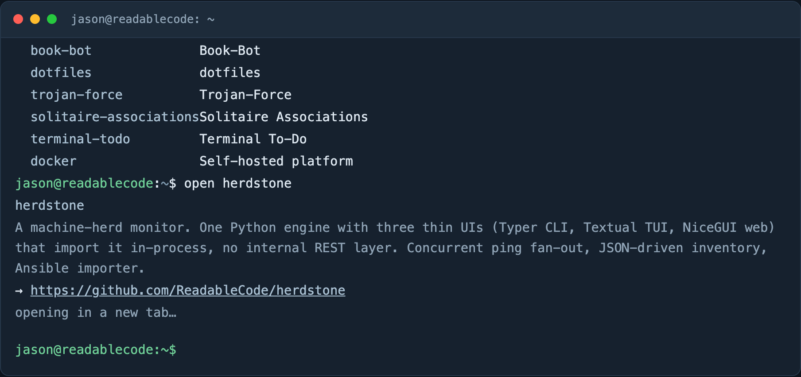
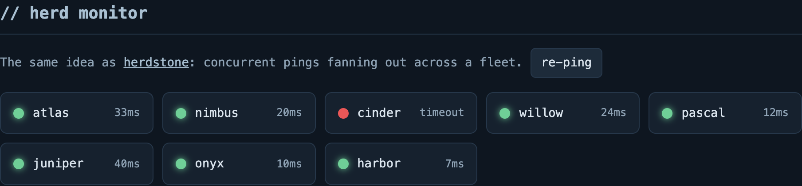
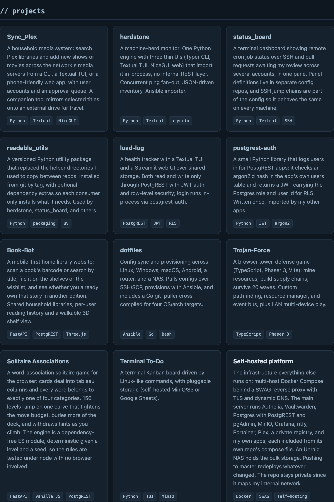
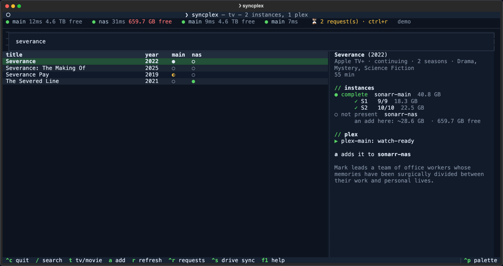
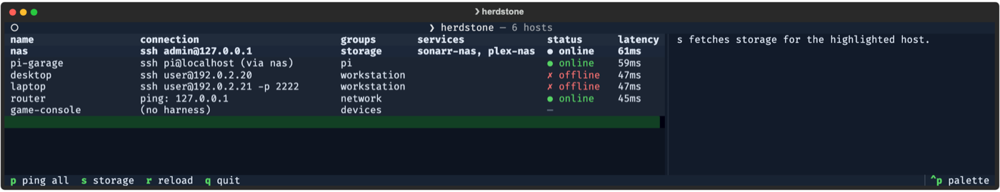
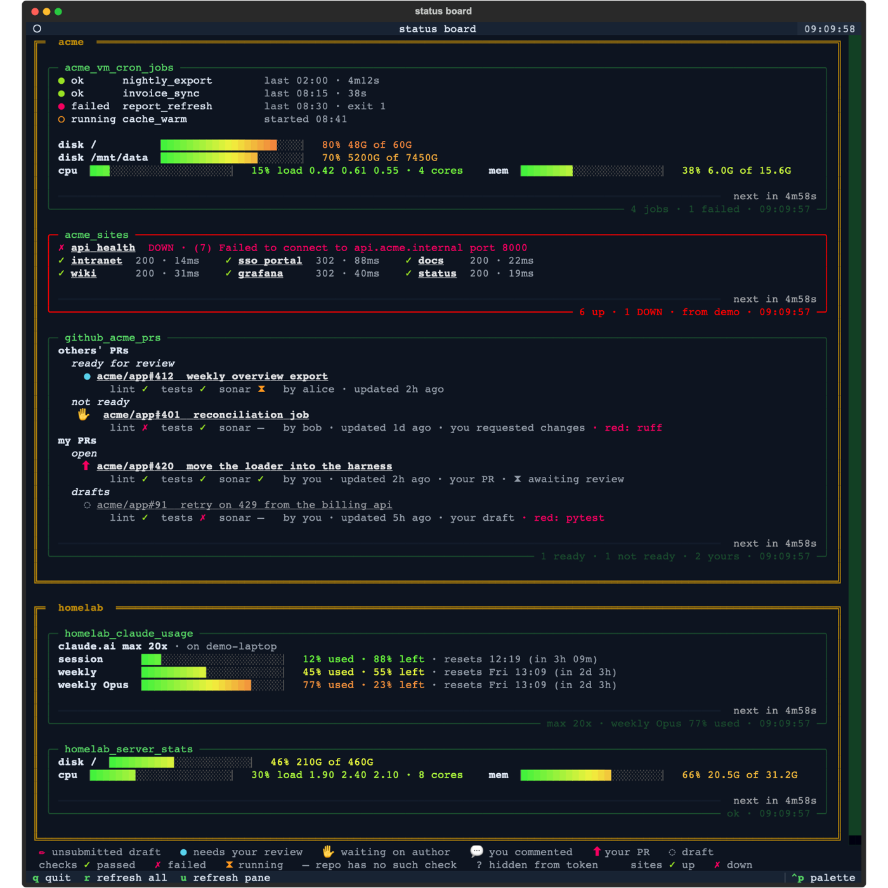
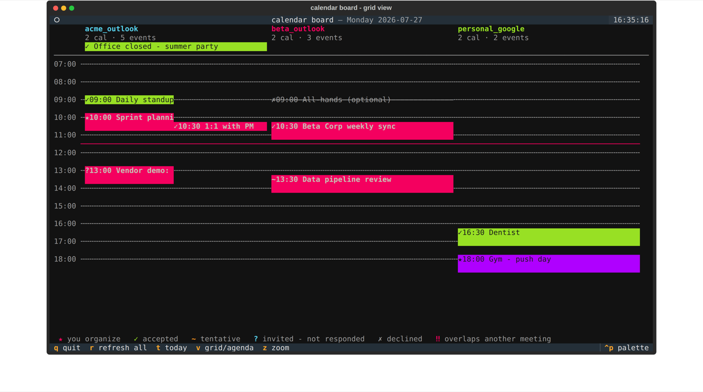
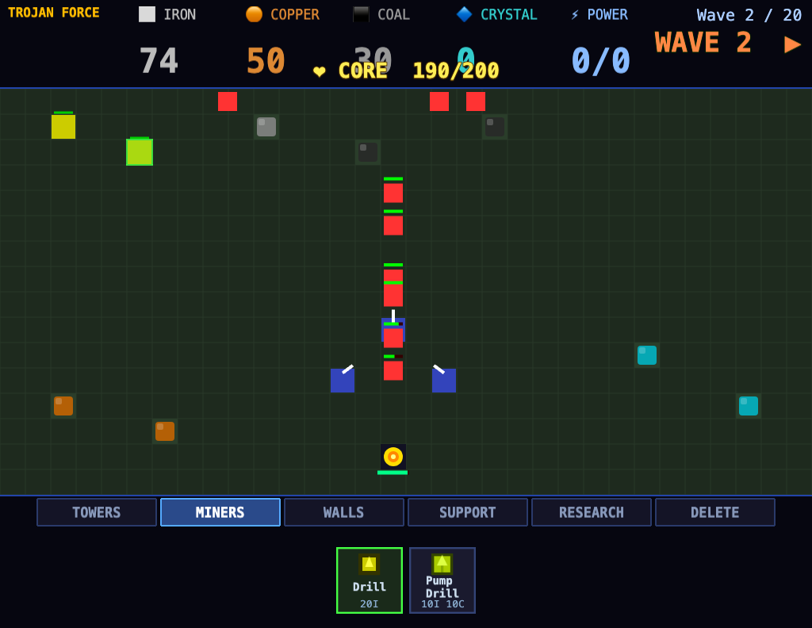
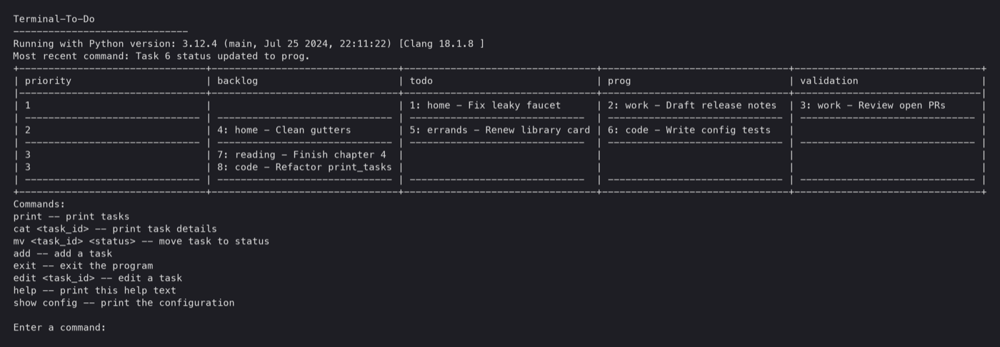

# readablecode.github.io

The static GitHub Pages copy of my portfolio. It is one page that shows the
projects I have built and the tools I use, presented as an interactive
terminal you can type into, a herdstone-style herd monitor animation, a
project browser, and a skills list.

The live version (React + FastAPI, self-hosted on my homelab) is at
[site.tinkernet.me](https://site.tinkernet.me). This repo is the plain
HTML/CSS/JS mirror that stays up on GitHub Pages with no server behind it.

- Live site: <https://site.tinkernet.me>
- GitHub: <https://github.com/ReadableCode>



## What is on the page

- **Terminal.** Type `help` and press enter. Commands: `about`, `whoami`,
  `skills`, `projects`, `ls`, `open <name>` (prints the project blurb and
  opens its repo in a new tab), `curl /api/my-info`, `theme`, `clear`.
  Up/down arrows walk the history and Tab completes command names. On this
  mirror `curl /api/my-info` prints a canned copy of the bio; the live site's
  FastAPI backend answers it for real.
- **Herd monitor.** The same idea as
  [herdstone](https://github.com/ReadableCode/herdstone): a grid of sample
  machines with simulated concurrent pings, each landing online with a
  latency or offline with a timeout. The `re-ping` button runs it again.
- **Live and self-hosted.** A badge that tries the live site's
  `/api/status` endpoint and shows its uptime when it answers, or a plain
  link when it does not.
- **Projects.** One card per project with a short blurb, tags, and a repo
  link. A project with no public repo shows without a link.
- **Skills.** Languages, frameworks and infrastructure grouped by area.
- A light/dark theme toggle, remembered in `localStorage`.





## Projects featured on the site

Screenshots come from each project's own repo, taken against demo data.

<table>
  <tr>
    <td width="50%" valign="top">
      <a href="https://github.com/ReadableCode/Sync_Plex"><b>Sync_Plex</b></a><br>
      Search Plex libraries and add shows or movies across media servers from a CLI, TUI or web app.<br><br>
      
    </td>
    <td width="50%" valign="top">
      <a href="https://github.com/ReadableCode/herdstone"><b>herdstone</b></a><br>
      Machine-herd monitor: one engine, three UIs, concurrent ping fan-out.<br><br>
      
    </td>
  </tr>
  <tr>
    <td valign="top">
      <a href="https://github.com/ReadableCode/status_board"><b>status_board</b></a><br>
      Terminal dashboard for remote cron jobs over SSH and PRs awaiting review.<br><br>
      
    </td>
    <td valign="top">
      <a href="https://github.com/ReadableCode/load-log"><b>load-log</b></a><br>
      Health tracker with a Textual TUI and a Streamlit web UI over PostgREST.<br><br>
      
    </td>
  </tr>
  <tr>
    <td valign="top">
      <a href="https://github.com/ReadableCode/Book-Bot"><b>Book-Bot</b></a><br>
      Home library website: scan a barcode to see whether you already own that book in any edition.<br><br>
      
    </td>
    <td valign="top">
      <a href="https://github.com/ReadableCode/dotfiles"><b>dotfiles</b></a><br>
      Config sync and provisioning across machines, including a terminal calendar board.<br><br>
      
    </td>
  </tr>
  <tr>
    <td valign="top">
      <a href="https://github.com/ReadableCode/Trojan-Force"><b>Trojan-Force</b></a><br>
      Browser tower-defense game in TypeScript and Phaser 3.<br><br>
      
    </td>
    <td valign="top">
      <a href="https://github.com/ReadableCode/Solitaire_Associations"><b>Solitaire Associations</b></a><br>
      Word-association solitaire with 150 levels.<br><br>
      
    </td>
  </tr>
  <tr>
    <td valign="top">
      <a href="https://github.com/ReadableCode/Terminal_To_Do"><b>Terminal To-Do</b></a><br>
      Terminal Kanban board driven by Linux-like commands.<br><br>
      
    </td>
    <td valign="top">
      Also featured, without a UI to show:
      <a href="https://github.com/ReadableCode/readable_utils">readable_utils</a>,
      <a href="https://github.com/ReadableCode/postgrest-auth">postgrest-auth</a>,
      and the private self-hosted platform the site runs on.
    </td>
  </tr>
</table>

## How it works

Everything is in `index.html`: inline CSS, inline JS, no build step and no
dependencies. The project list, skills and bio are plain arrays at the top of
the script, and the terminal output, project cards and skills list all render
from them, so adding a project means adding one entry to `PROJECTS`.

## Running it locally

Open `index.html` in a browser, or serve the folder:

```sh
python3 -m http.server 8000
```

then visit <http://localhost:8000>.

## Deployment

The site deploys from the `main` branch through GitHub's built-in Pages
pipeline. `.nojekyll` makes Pages serve the files as they are.
`.github/workflows/pages.yml` is a manual fallback: run "Deploy site to
GitHub Pages" from the Actions tab only if the built-in pipeline gets stuck.
